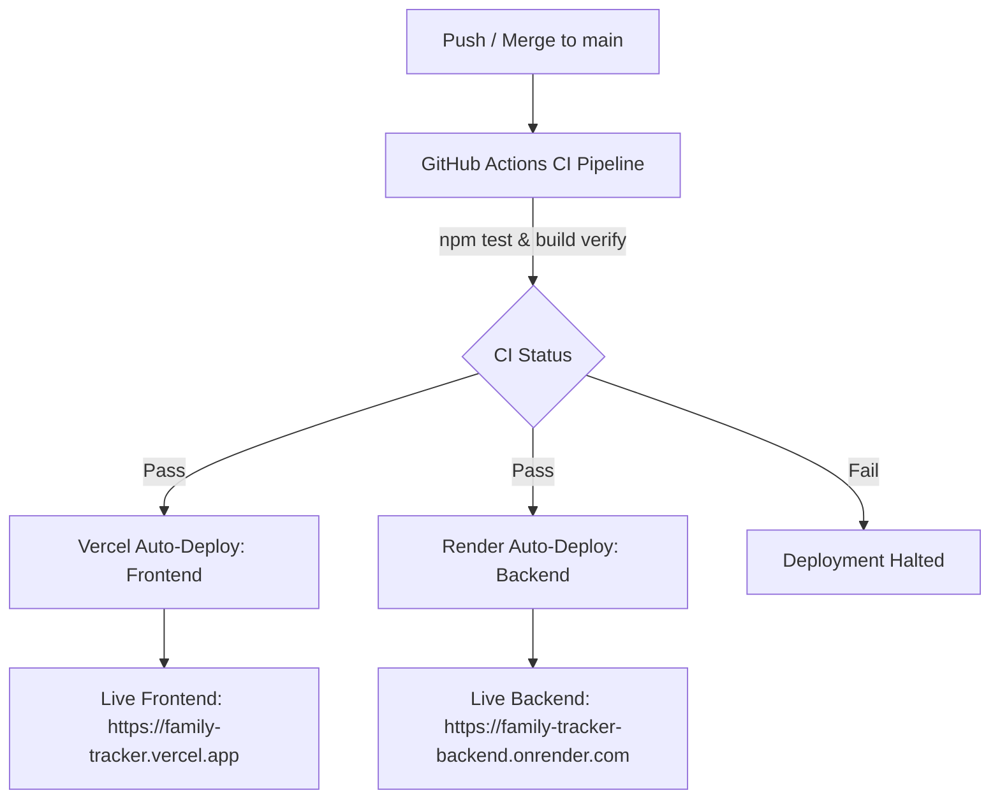

# 🌐 FamilyTracker — Continuous Deployment (CI/CD) Guide

This guide details how **FamilyTracker** automatically builds, tests, and deploys to **Vercel** (frontend) and **Render** (backend) on every `git push origin main`.

---

## 🚀 Continuous Deployment Architecture

---

## 1. Setting Up Automatic Deployments on Vercel (Frontend)

1. Navigate to **[Vercel Dashboard](https://vercel.com/dashboard)**.
2. Click **Add New...** $\rightarrow$ **Project**.
3. Under **Import Git Repository**, choose `KARTHI2509/Family-Tracker`.
4. Configure Project Settings:
   - **Framework Preset:** `Vite`
   - **Root Directory:** Click `Edit` and select `frontend`
   - **Build Command:** `npm run build`
   - **Output Directory:** `dist`
   - **Install Command:** `npm ci`
5. In **Environment Variables**, add:
   | Variable | Value | Description |
   | :--- | :--- | :--- |
   | `VITE_API_URL` | `https://YOUR-RENDER-BACKEND.onrender.com/api` | Render backend API endpoint |
   | `VITE_SOCKET_URL` | `https://YOUR-RENDER-BACKEND.onrender.com` | Render Socket.IO server URL |
6. Click **Deploy**.
7. Enable **Automatic Deployments**: Under **Settings** $\rightarrow$ **Git**, verify the production branch is set to `main`. Every subsequent push to `main` will automatically trigger a production build.

---

## 2. Setting Up Automatic Deployments on Render (Backend)

1. Navigate to **[Render Dashboard](https://dashboard.render.com/)**.
2. Click **New +** $\rightarrow$ **Web Service**.
3. Connect the GitHub repository `KARTHI2509/Family-Tracker`.
4. Configure Web Service Settings:
   - **Name:** `familytracker-backend`
   - **Region:** Closest to your users (e.g., Singapore, Frankfurt, Oregon)
   - **Branch:** `main`
   - **Root Directory:** `backend`
   - **Runtime:** `Node`
   - **Build Command:** `npm ci`
   - **Start Command:** `npm start`
   - **Auto-Deploy:** `Yes`
   - **Health Check Path:** `/api/health`
5. Under **Environment Variables**, add:
   | Variable | Value | Description |
   | :--- | :--- | :--- |
   | `NODE_ENV` | `production` | Production mode |
   | `PORT` | `3001` | Server port |
   | `JWT_SECRET` | *(Generate a random 32+ char secret)* | JWT signature key |
   | `CORS_ORIGIN` | `https://YOUR-VERCEL-DOMAIN.vercel.app` | Allowed Vercel frontend origin |
   | `FRONTEND_URL` | `https://YOUR-VERCEL-DOMAIN.vercel.app` | Frontend origin for Socket.IO |
   | `DB_PATH` | `/data/familytracker.db` | Persistent SQLite path |
   | `MONGODB_URI` | *(Optional MongoDB Atlas URI)* | Cloud database option |
6. Under **Disks** (if using SQLite):
   - **Name:** `familytracker-data`
   - **Mount Path:** `/data`
   - **Size:** `1 GB`
7. Click **Create Web Service**. Every push to `main` will now automatically build and restart the backend.

---

## 3. GitHub Actions CI Quality Gate

The workflow located at `.github/workflows/ci.yml` runs automatically on:
- Every `push` to `main`
- Every `pull_request` targeting `main`

### What it verifies:
1. Installs clean dependencies using `npm ci` on Node 20.x.
2. Runs the complete backend test suite:
   - Auth & Role-based security (User, Admin, Super Admin)
   - Family circles, invite codes, and strict privacy isolation
   - Geofence safe zones and entry/exit calculation
   - SOS distress broadcasts with nullable coordinates
   - Journey tracking, safe arrival, and emergency check-in
   - Socket.IO multi-device session tracking
   - 7-day location retention cleanup
3. Verifies frontend production compilation (`npm run build`).

---

## 4. Secret Protection & Rotation

> [!CAUTION]
> Never commit `.env` files or raw database backups to GitHub.

- **To rotate `JWT_SECRET`:** Update the `JWT_SECRET` variable in the Render Dashboard and click **Save Changes** (Render will automatically redeploy). Existing user sessions will expire and require re-login.
- **To update Database URI:** Update `MONGODB_URI` or `DATABASE_URL` in the Render Dashboard.
